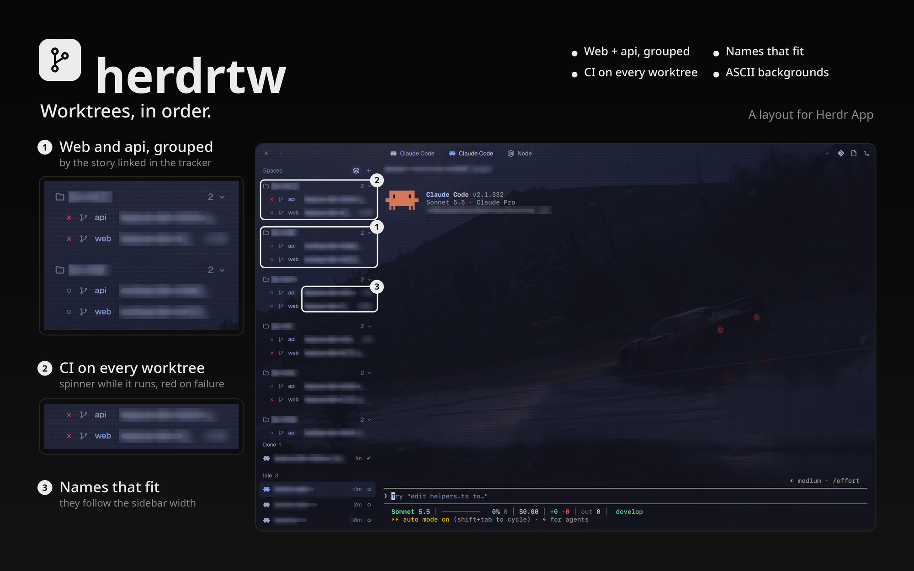
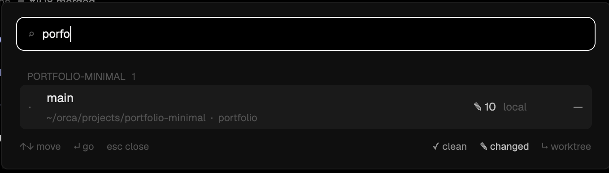

# Herdrtw

A monochrome Herdr layout built around the terminal: a sidebar with your spaces and agents, a thin tab bar with a context line, and an optional blurred background image.



Install:

```sh
sh scripts/install.sh
herdr-app do layout.switch '{"name":"herdrtw"}'
```

The installer copies the layout, the theme and the `herdrtw` and `goto` mods into `~/.config/herdr-app` (or `$HERDR_APP_HOME`), adds the layout's keys to `keys.json` without replacing any you already use, and checks both mods.

Keys (only while the layout is shown): `ctrl-alt-w` opens the new worktree dialog, `ctrl-alt-b` opens the background image dialog, `cmd-shift-o` opens Go to.

**Go to** (`mods/goto`) jumps between your projects and worktrees: grouped by repository, the branch first, git state (`✓` clean, `✎ n` changed, `↑`/`↓` against the remote, `local` without upstream), how long ago you last used each one, and fuzzy search over branch, repo, name and folder. The previous space comes preselected, so `cmd-shift-o` then `Enter` takes you back.

Programs the mod runs: `git`, `gh` (pull request state), `sh`, `cp`, `mkdir`, `rm`. The background dialog also uses `ffmpeg` and a file picker (`zenity` or `kdialog` on Linux, `osascript` on macOS, PowerShell on Windows). Nothing reaches the network except what `git` and `gh` do.

See `RECIPE.md` for the full description. `NOTICE` lists the Apache-2.0 code derived from Herdr's own mods and the CC BY 3.0 icon.

## Screenshots



