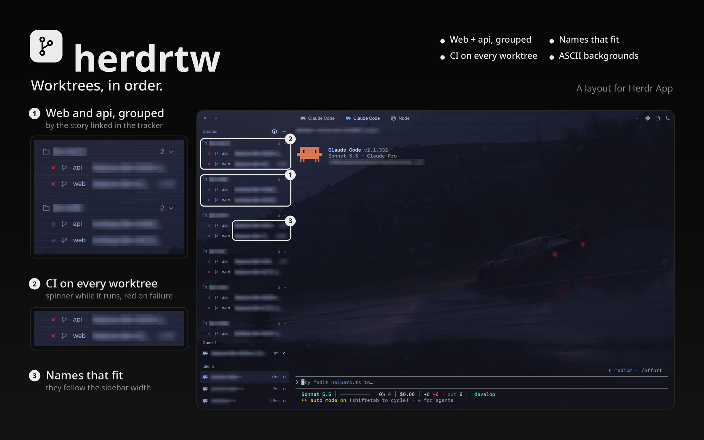

# Herdrtw

A monochrome Herdr window made for the terminal. On the left, your spaces with their git worktrees nested under the repo, and your agents below them. On the right, a thin tab bar, a one-line context strip (branch, worktree, pull request state) and the terminal filling everything else. Panels, headers and borders are gone; surfaces are translucent so an optional blurred background image shows through.

## What you see

Left to right, a sidebar (268 px, 44 to 480, not resizable by drag) and the work area. No system title bar. Colors are the theme's names; the layout sets only `theme: "herdrtw"`, so the theme picker changes everything.

- **Sidebar**, transparent (theme `chrome` at 0% alpha), two blocks stacked:
  - **Top strip**, 42 px, drags the window. Where the system draws no window buttons (`window().buttons`): a close `×` (13 px) then a minimize `−`, 30 px cells, `dim`, `foreground` on hover. No maximize button.
  - **Spaces** (fills the rest), 14 px text. A 34 px head `Spaces` (12.5 px, `dim`) with a 30 px `+`. Space rows are 34 px, a worktree under its checkout 30 px, radius 6, `selected` behind the current one, `hover` under the pointer. A space starts with a 14 px square, 1.5 px border: outlined in `muted`, or filled `foreground` when current. A worktree row is indented 14 px and starts with a 10 px slot holding a 6 px pull-request dot (outlined `dim` when open, draft or closed, filled `dim` when merged), then herdr's branch icon (13 px, `dim`). Branch and pull request details are in tooltips (`branch` then `PR #n · open|draft|merged|closed`). At the right only `↑2 ↓1` ahead/behind, in `muted`.
  - **Agents** (bottom), no header, a 1 px `border` line above. Rows 34 px, radius 6, `selected` behind the focused agent, the program's icon (16 px, `accent` when focused else `muted`), the name, the time since its last change (`dim`, 12 px) and the status mark. The block's height follows its content: at least 144 px (a group heading and 3 rows), at most half the sidebar, then it scrolls. Order is fixed by urgency: Needs you, Done, Working, Idle, with `Pinned` first. Group headings are 34 px, 12 px medium in `muted`, count in `dim`.
- **Tab bar**, 42 px, drags the window. Tab pills 30 px high, radius 8, 13 px text, 14 px side padding, 7 px between icon and name. The active tab sits on `raised`; the others on the bar. Each tab starts with the program's icon (15 px, tinted: `accent` active, `muted` otherwise) then the tab's name (or the program's name when nobody named it), then an agent mark. The `×` appears only while the pointer is on the tab. A lone tab shows just its icon, no pill, name in a tooltip. At the right: `+`, the Git button (the Git logo, 14 px), Files and Changes (icons only), 30 px cells, radius 8.
- **Context line**, 28 px, 12.5 px `dim`: the branch (`muted`), the space's name after a `·` only when it differs from the branch ignoring case and punctuation, `↑n ↓n`, then the pull request: a 7 px dot and `#n merged|open|draft|closed`. Empty without a git repo.
- **Terminal**, the rest, padding `[10, 12]`, no frame, no pane header, panes 4 px apart, the focused one gets a 1 px `muted` line. `terminal_opacity` is 0 so a background image shows behind the text.
- **Files / Changes panel**, 368 px (280 to 900), hidden until you press its tab bar button; it takes space from the terminal.

Theme `herdrtw`: background `#000000`, text `#e6e6e6`, selection `#2a2a2a`, `chrome` `#000000`, `popover` and `raised` `#0d0d0d`, `hover` `#141414`, `selected` `#1c1c1c`, `border` `#1f1f1f`, `input` `#2e2e2e`, `muted` `#8a8a8a`, `dim` `#5c5c5c`, `accent` `#ffffff`, ANSI colors all greys. Fonts come from the person's settings.

## How it behaves

- **Agent marks** (no color, only shape and motion): working is a 6 to 7 px dot breathing (opacity 0.3 to 1, 1.6 s); needs you is a 9 px square blinking (0.2 to 1, 0.9 s); done is a `✓`; idle is a 7 px ring in `dim`. The same marks show in the tab bar, after the tab's name.
- **Folding**: hovering a space that has worktrees nested under it shows a chevron at the right of its row; clicking it hides or shows those worktrees. Folded, the chevron stays visible with the count (`› 14`). The folded state is kept per repository, and the current worktree stays visible.
- **Clicks**: a space or worktree row selects it; right-click opens herdr's own menu; rows drag to reorder. An agent row focuses its pane. The Git button opens the new worktree dialog. Files and Changes toggle the right panel.
- **Keys** (`keys.json`, section `layout:herdrtw`): `ctrl-alt-w` the new worktree dialog, `ctrl-alt-b` the background dialog, `cmd-shift-o` Go to. They are the commands `herdrtw.worktree`, `herdrtw.bg` and `mod.open:goto`.
- **Go to** (popup at the top, 680 × 540, 56 px down): a search field, then your spaces grouped by repository, a worktree under its repo marked `↳`, spaces outside git under `Other`. Each row shows the branch (13.5 px), the path and the space's name below in `dim`, then the git state: `✓` clean, `✎ n` changed files, `↑n`/`↓n` against the upstream, `local` without one. At the right, the time since its last use (`now`, `12 min`, `3 h`, `yesterday`, `4 d`, then the date); the current space is marked `current`, the previous one `↩ previous` and comes preselected, so opening and pressing Enter goes back. Typing filters with fuzzy matching: every word must hit one field, matches in the branch weigh most, then repo and space name, then folder (`1234` finds `feature/1234-login`). `↑↓` or `ctrl-n`/`ctrl-p` move, Enter selects the space, Esc closes. Git state comes from one `sh` call per machine (`git rev-parse` and `git status --porcelain=v2 --branch` over all the folders, 10 s timeout); the last answer is kept across openings, so the list shows it at once and refreshes in the background, and a machine that does not answer keeps its last known state. Times since last use come from `goto-tracker`, an invisible floating copy of the mod in the layout that stamps, in `shared("goto.visits")`, the space left and the space entered each time the focused space changes; shared state survives restarts. Spaces not visited since the tracker was installed show `—`.
- **Worktree dialog** (440 × 630): a display name (the sidebar label, defaults to the branch name), the git branch (created, or checked out if it exists), the base branch (starts as the current space's branch, with suggestions from the repo's local and remote branches; ↑/↓ pick, Tab or Enter accept), a startup script dropdown (`No script`, the entries of `scripts.json`, `Custom…` with a `save` button that adds it to `scripts.json`; the first match among `composer.json`/`artisan` and `package.json` is preselected), and a checkbox to copy files from the current checkout. Creating runs checks (branch name valid, branch not already checked out, folder free, base exists), fetches the base if it is `<remote>/<branch>`, runs `git worktree add` into `~/.herdr/worktrees/<repo>/<branch>`, copies the paths listed in `inherit.json`, runs its `after` hooks, then opens a space named after the display name with the startup script running in its terminal. The footer names the current step.
- **Background dialog** (420 × 340): choose an image with the system file picker, set opacity (5 to 100 %, steps of 5, default 15) and blur (0 to 40 px, steps of 2, default 8), Apply, or Remove. Apply builds a 1920 × 1080 image (cover) blurred and blended with the theme's background color and writes it to `backgrounds/herdrtw-bg-<time>.png` and to the layout's root `background`.
- **Pull request state**: asked per branch with `gh pr list --head <branch> --state all --limit 1`, cached 90 s, refreshed every 2 minutes. Remote machines are skipped.

## Built from

- **Layout** `layouts/herdrtw.json`, root `row` (`titlebar: none`, `traffic_lights: [12, 16]`, `terminal_padding: [10, 12]`, `terminal_opacity: 0`, `theme: herdrtw`, `background: canvas`): `sidebar` (column, 268 px, `resizable: false`) holding `brand` (42 px, `window_drag`) and `sidebar-lists` (column) with `spaces` (weight 1, min 90) and `agents` (px, min 36; its height is set at run time); `work` (column) holding `tabs` (42 px, `window_drag`), `context` (28 px), and `work-body` (row) with `main` (`{"tab": "active", "pane": {"focus": {...}, "radius": 0, "gap": 4}}`) and `panel` (368 px, hidden) with a stack of `files` and `changes`.
- **One mod**, `mods/herdrtw`, picked per block with `props.part`: `chrome`, `spaces`, `agents`, `tabs`, `context`, plus the dialogs `worktree` and `bg`. Shared code is in `lib/common.js`. `tabs`, `spaces`, `agents` and `worktree` derive from herdr's shipped mods (Apache-2.0, see `NOTICE`).
- **Go to mod**, `mods/goto`: `main.js` picks the part (`props.part: "tracker"` for the floating `goto-tracker`, otherwise the popup), `goto-panel.js` the popup, `fuzzy-match.js`, `space-git-status.js` (git facts per folder), `visit-tracker.js` (last use per space).
- **Shipped mods used**: `files`, `changes` (the panel), `menu` (right-click).
- **Herdr API**: `spaces()`, `panes()`, `agents()`, `terminals()`, `focused()`, `layout()`, `window()`, `shared`/`setShared` (`herdrtw.ctx` per-space branch and PR, `sidebar.spaces.h`), `exec`, `readTextFile`/`writeTextFile`, `openOverlay`/`closeOverlay`, `nextCommand`; commands `layout.resize`, `space.new {folder, name, argv}`, `space.select`, `tab.*`, `pane.focus`, `terminal.pin`, `window.minimize`, `window.close`.
- **Programs**: `git`, `gh`, `sh`, `cp`, `mkdir`, `rm`, `ffmpeg`, `zenity` or `kdialog` (Linux), `osascript` (macOS), `powershell` (Windows).
- **Art**: the Git logo (`git.svg`, CC BY 3.0), the window control SVGs.
- **Config** in the mod folder: `scripts.json` (startup scripts), `inherit.json` (paths to copy, `after` hooks, `fetch`, per-repo `base` and `script`), `bg.json` (background choices, written by the dialog).

## Watch out

- Surfaces are transparent only while the shown layout is named `herdrtw`; the mods check `shared("layout")`. Rename the layout and the transparency goes with it.
- Translucency adds an alpha pair to `#rrggbb` colors; a theme with another color format keeps those surfaces solid.
- The agents block is resized with `layout.resize` from the agents part, using the spaces part's measured height; both must be present.
- `window_drag` areas open the system window menu on right-click on Linux. Only `brand` and `tabs` use it; keep it off the lists.
- Tooltips use `tooltip()`; the second line of a tooltip may render on one line.
- `✓` and the dots depend on the UI font.
- Without `gh` signed in, no pull request state appears (no error).
- Without `ffmpeg` Apply reports the error; without a file picker the dialog says so.
- Key delivery of `herdrtw.<command>` reaches shown copies; the commands are handled by the `tabs` part.
- Not verified on macOS or Windows.

## Done when

- `herdr-app check mods/herdrtw` passes and `herdr-app status` shows no errors with the layout shown.
- `herdr-app do layout.switch '{"name":"herdrtw"}'` shows the sidebar, the tab bar, the context line and a full-width terminal.
- `herdr-app do herdrtw.worktree` and `herdr-app do herdrtw.bg` each open their dialog.
- A worktree with a pull request shows its dot, and its tooltip reads the branch and `PR #n · state`.
- With one agent the agents block is 144 px; with many it stops at half the sidebar and scrolls.
- Choosing an image and pressing Apply puts a blurred, dimmed copy behind the terminal; Remove restores the plain background.
